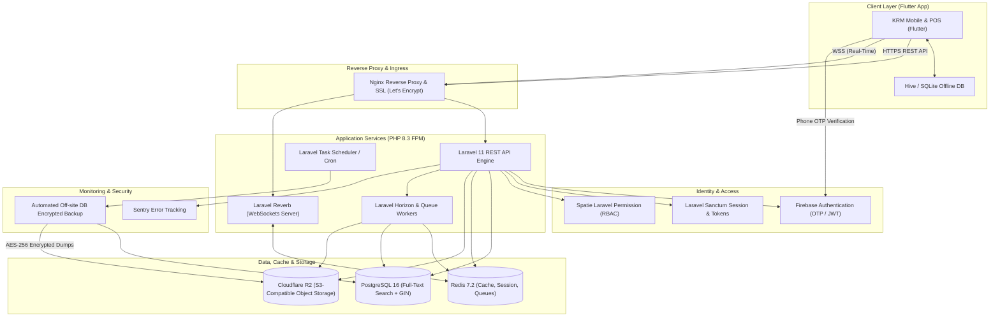
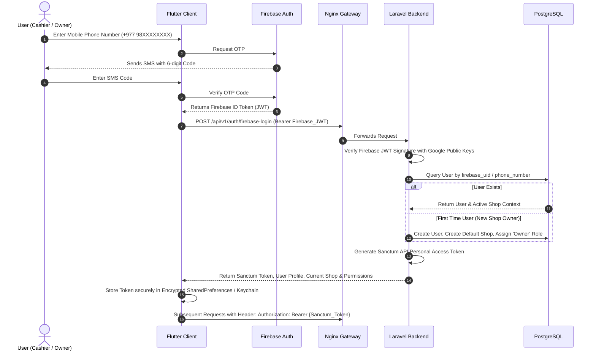
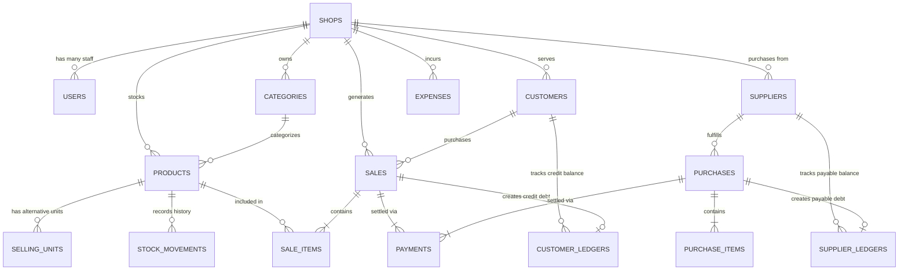

# KRM Kirana & Retail Management System — Full Architecture & System Design

**Document Version:** 1.0.0  
**Target Environment:** Production (AWS Lightsail + Docker Compose)  
**Client Applications:** Flutter Mobile & Desktop Apps (`N:\krm\app`)  
**Backend Core:** PHP 8.3 / Laravel 11 / PostgreSQL 16 / Redis 7.2  

---

## 1. Executive Summary & High-Level Architecture

The **KRM Kirana & Retail Management System** is an offline-resilient, real-time Point of Sale (POS), Inventory, Credit (Udhar Khata), and Multi-Party Retail Platform. It is engineered to handle fast transactional POS throughput, bilingual product lookups (English/Nepali), double-entry customer/supplier ledgers, and real-time inventory synchronization across multi-counter retail establishments.

### System Architecture Diagram



---

## 2. Core Technology Matrix

| Layer / Capability | Technology Selection | Justification & Responsibility |
| :--- | :--- | :--- |
| **Language** | PHP 8.3+ | Strong typing, fibers, JIT, read-only classes, constructor property promotion |
| **Framework** | Laravel 11.x | Micro-modular architecture, standard Eloquent ORM, robust ecosystem |
| **Primary Database** | PostgreSQL 16 | ACID transactions, native JSONB, GIN indexing, Full-Text Search (`tsvector`) |
| **Cache & Key-Value** | Redis 7.2 Alpine | Sub-millisecond session state, query caching, queue broker, Pub/Sub |
| **Client Authentication** | Firebase Auth (Phone OTP) | Low-latency SMS verification, global carrier reliability, token claims |
| **API Authentication** | Laravel Sanctum | Stateful tokens for API clients tied to verified Firebase UIDs |
| **Role-Based Access** | Spatie Laravel Permission | Granular role hierarchies (`Owner`, `Manager`, `Cashier`, `Accountant`) |
| **API Architecture** | RESTful JSON API + OpenAPI 3.0 | Strict JSON:API compliance, typed resource transformers, Swagger UI |
| **Queue & Background** | Laravel Queues + Redis | Asynchronous receipt PDF generation, SMS alerts, audit archiving |
| **Queue Monitoring** | Laravel Horizon | Live metrics, job throughput, wait times, automated worker scaling |
| **Real-Time WebSockets**| Laravel Reverb | High-concurrency event broadcasting: live cart, stock alerts, POS sync |
| **Search Engine** | PostgreSQL Full-Text Search | Multilingual token matching with `to_tsvector('simple', ...)` and `pg_trgm` |
| **Object Storage** | Cloudflare R2 | Zero-egress fee S3-compatible cloud storage for product photos & PDFs |
| **Testing Suite** | Pest PHP 3.x | Concise, expressive unit & integration testing with mock assertions |
| **Static Analysis** | Larastan / PHPStan (Level 8) | Strict compile-time safety and zero implicit conversions |
| **Code Style** | Laravel Pint | Automated PSR-12 and Laravel standard linting enforcement |
| **Application Monitor**| Sentry Laravel SDK | Real-time uncaught exception reporting, breadcrumbs, performance traces |
| **Ingress Web Server** | Nginx 1.25 Alpine | HTTP/2, Let's Encrypt TLS termination, WebSocket proxy, rate-limiting |
| **Containerization** | Docker + Docker Compose | Isolated multi-container micro-stack with health checks |
| **Process Control** | Supervisor 4.x | Auto-restarts for PHP-FPM, Horizon workers, and Reverb daemons |
| **Deployment / CI** | GitHub Actions + AWS Lightsail | Continuous linting, testing, Docker build & zero-downtime SSH deploy |

---

## 3. Multi-Tenant Shop Architecture & Security Isolation

Every business entity using the KRM platform operates inside an isolated tenant context called a **Shop**.

### Tenant Scoping Model
- All core tables (`products`, `sales`, `customers`, `suppliers`, `expenses`, `ledgers`) include a required `shop_id UUID` foreign key with a composite index `(shop_id, id)`.
- Eloquent Models enforce tenant isolation through a global scope `TenantScope`:
  ```php
  static::addGlobalScope('shop', function (Builder $builder) {
      if (auth()->check() && auth()->user()->current_shop_id) {
          $builder->where('shop_id', auth()->user()->current_shop_id);
      }
  });
  ```
- Cross-tenant data leaks are structurally prevented at both the application level (Global Scope) and the database level (Foreign key composite unique constraints).

---

## 4. Authentication & Authorization Architecture

### Firebase Auth + Laravel Sanctum Hybrid Handshake



### Role-Based Access Control (Spatie Permissions Matrix)

| Module / Action | Owner | Store Manager | Cashier | Accountant |
| :--- | :---: | :---: | :---: | :---: |
| **New POS Sale Creation** | Yes | Yes | Yes | No |
| **Cancel / Void Invoice** | Yes | Yes | Requires PIN | No |
| **Apply Custom Sale Discount** | Yes | Yes (Up to 15%) | Fixed only | No |
| **Collect Udhar Payment** | Yes | Yes | Yes | Yes |
| **Adjust Stock Quantity** | Yes | Yes | No | No |
| **Set Low Stock Alert** | Yes | Yes | No | No |
| **View Profit / Cost Margins** | Yes | Yes | No | Yes |
| **Add / Edit Customers** | Yes | Yes | Yes | Yes |
| **Add / Edit Suppliers** | Yes | Yes | No | Yes |
| **Record Shop Expense** | Yes | Yes | No | Yes |
| **Export Ledger / Tax Reports**| Yes | Yes | No | Yes |
| **Shop Settings & Staff Mgmt** | Yes | No | No | No |

---

## 5. Comprehensive Database Schema & Entity Relationship (PostgreSQL 16)



### Detailed Table Specifications

#### 1. Core Tenant & Identity Tables
- **`shops`**: `id UUID PRIMARY KEY`, `name VARCHAR(150)`, `business_type VARCHAR(50)`, `pan_vat_number VARCHAR(30)`, `phone VARCHAR(20)`, `email VARCHAR(100)`, `currency VARCHAR(10) DEFAULT 'Rs.'`, `address TEXT`, `receipt_header TEXT`, `receipt_footer TEXT`, `low_stock_threshold_default INT DEFAULT 5`, `created_at`, `updated_at`.
- **`users`**: `id UUID PRIMARY KEY`, `firebase_uid VARCHAR(128) UNIQUE`, `name VARCHAR(100)`, `phone VARCHAR(20) UNIQUE`, `email VARCHAR(120) NULL`, `current_shop_id UUID REFERENCES shops(id)`, `avatar_url TEXT NULL`, `is_active BOOLEAN DEFAULT true`, `last_login_at TIMESTAMP NULL`, `created_at`, `updated_at`.
- **`shop_users`**: `id UUID PRIMARY KEY`, `shop_id UUID REFERENCES shops(id) ON DELETE CASCADE`, `user_id UUID REFERENCES users(id) ON DELETE CASCADE`, `role VARCHAR(50)`, `pin_code_hash VARCHAR(255) NULL`, `created_at`, `UNIQUE(shop_id, user_id)`.

#### 2. Products, Categories & Inventory Tables
- **`categories`**: `id UUID PRIMARY KEY`, `shop_id UUID REFERENCES shops(id) ON DELETE CASCADE`, `name VARCHAR(100)`, `slug VARCHAR(120)`, `icon VARCHAR(50) NULL`, `color VARCHAR(30) NULL`, `created_at`, `updated_at`, `UNIQUE(shop_id, slug)`.
- **`products`**: `id UUID PRIMARY KEY`, `shop_id UUID REFERENCES shops(id) ON DELETE CASCADE`, `category_id UUID REFERENCES categories(id) ON DELETE SET NULL`, `name VARCHAR(200)`, `nepali_name VARCHAR(200) NULL`, `sku VARCHAR(60)`, `barcode VARCHAR(100) NULL`, `description TEXT NULL`, `purchase_price NUMERIC(12,2) DEFAULT 0`, `purchase_unit VARCHAR(30) DEFAULT 'Piece'`, `selling_price NUMERIC(12,2) NOT NULL`, `selling_unit VARCHAR(30) DEFAULT 'Piece'`, `stock_quantity NUMERIC(12,3) DEFAULT 0`, `secondary_stock NUMERIC(12,3) NULL`, `secondary_unit VARCHAR(30) NULL`, `unit_conversion_factor NUMERIC(10,4) DEFAULT 1.0`, `low_stock_threshold NUMERIC(12,3) DEFAULT 5`, `enable_low_stock_alert BOOLEAN DEFAULT true`, `image_url TEXT NULL`, `gallery_images JSONB DEFAULT '[]'`, `search_vector TSVECTOR`, `created_at`, `updated_at`.
- **`selling_units`**: `id UUID PRIMARY KEY`, `shop_id UUID REFERENCES shops(id) ON DELETE CASCADE`, `product_id UUID REFERENCES products(id) ON DELETE CASCADE`, `unit_name VARCHAR(50)`, `conversion_rate NUMERIC(10,4) NOT NULL`, `selling_price NUMERIC(12,2) NOT NULL`, `is_default BOOLEAN DEFAULT false`, `is_active BOOLEAN DEFAULT true`, `created_at`, `updated_at`.
- **`stock_movements`**: `id UUID PRIMARY KEY`, `shop_id UUID REFERENCES shops(id) ON DELETE CASCADE`, `product_id UUID REFERENCES products(id) ON DELETE CASCADE`, `user_id UUID REFERENCES users(id) ON DELETE SET NULL`, `movement_type VARCHAR(30)` (`'SALE'`, `'PURCHASE'`, `'ADJUSTMENT_ADD'`, `'ADJUSTMENT_REMOVE'`, `'RETURN'`), `quantity NUMERIC(12,3) NOT NULL`, `unit VARCHAR(30)`, `stock_before NUMERIC(12,3) NOT NULL`, `stock_after NUMERIC(12,3) NOT NULL`, `reference_type VARCHAR(50) NULL`, `reference_id UUID NULL`, `reason VARCHAR(255) NULL`, `note TEXT NULL`, `created_at`.

#### 3. Customers, Suppliers & Double-Entry Ledgers
- **`customers`**: `id UUID PRIMARY KEY`, `shop_id UUID REFERENCES shops(id) ON DELETE CASCADE`, `name VARCHAR(150)`, `phone VARCHAR(25)`, `address TEXT NULL`, `credit_limit NUMERIC(12,2) DEFAULT 0`, `outstanding_udhar NUMERIC(12,2) DEFAULT 0`, `is_active BOOLEAN DEFAULT true`, `created_at`, `updated_at`, `UNIQUE(shop_id, phone)`.
- **`customer_ledgers`**: `id UUID PRIMARY KEY`, `shop_id UUID REFERENCES shops(id) ON DELETE CASCADE`, `customer_id UUID REFERENCES customers(id) ON DELETE CASCADE`, `transaction_type VARCHAR(30)` (`'CREDIT_SALE'`, `'PAYMENT_RECEIVED'`, `'DISCOUNT_ALLOWED'`, `'OPENING_BALANCE'`), `reference_no VARCHAR(60)`, `amount NUMERIC(12,2) NOT NULL`, `balance_after NUMERIC(12,2) NOT NULL`, `payment_method VARCHAR(40) NULL`, `recorded_by UUID REFERENCES users(id)`, `note TEXT NULL`, `created_at`.
- **`suppliers`**: `id UUID PRIMARY KEY`, `shop_id UUID REFERENCES shops(id) ON DELETE CASCADE`, `name VARCHAR(150)`, `company_name VARCHAR(150) NULL`, `phone VARCHAR(25)`, `pan_number VARCHAR(30) NULL`, `address TEXT NULL`, `outstanding_payable NUMERIC(12,2) DEFAULT 0`, `created_at`, `updated_at`.
- **`supplier_ledgers`**: `id UUID PRIMARY KEY`, `shop_id UUID REFERENCES shops(id) ON DELETE CASCADE`, `supplier_id UUID REFERENCES suppliers(id) ON DELETE CASCADE`, `transaction_type VARCHAR(30)` (`'PURCHASE_BILL'`, `'PAYMENT_MADE'`, `'PURCHASE_RETURN'`), `reference_no VARCHAR(60)`, `amount NUMERIC(12,2) NOT NULL`, `balance_after NUMERIC(12,2) NOT NULL`, `payment_method VARCHAR(40) NULL`, `recorded_by UUID REFERENCES users(id)`, `note TEXT NULL`, `created_at`.

#### 4. Sales, Invoices & Payments
- **`sales`**: `id UUID PRIMARY KEY`, `shop_id UUID REFERENCES shops(id) ON DELETE CASCADE`, `receipt_number VARCHAR(40) NOT NULL`, `customer_id UUID REFERENCES customers(id) ON DELETE SET NULL`, `cashier_id UUID REFERENCES users(id) ON DELETE SET NULL`, `subtotal NUMERIC(12,2) NOT NULL`, `discount_type VARCHAR(20) DEFAULT 'fixed'`, `discount_amount NUMERIC(12,2) DEFAULT 0`, `tax_percentage NUMERIC(5,2) DEFAULT 0`, `tax_amount NUMERIC(12,2) DEFAULT 0`, `grand_total NUMERIC(12,2) NOT NULL`, `payment_status VARCHAR(25)` (`'PAID'`, `'PARTIAL'`, `'CREDIT'`, `'CANCELLED'`), `primary_payment_method VARCHAR(30)`, `cash_tendered NUMERIC(12,2) DEFAULT 0`, `change_returned NUMERIC(12,2) DEFAULT 0`, `udhar_amount NUMERIC(12,2) DEFAULT 0`, `items_count INT NOT NULL`, `note TEXT NULL`, `is_cancelled BOOLEAN DEFAULT false`, `cancelled_reason TEXT NULL`, `cancelled_at TIMESTAMP NULL`, `created_at`, `updated_at`, `UNIQUE(shop_id, receipt_number)`.
- **`sale_items`**: `id UUID PRIMARY KEY`, `sale_id UUID REFERENCES sales(id) ON DELETE CASCADE`, `product_id UUID REFERENCES products(id) ON DELETE RESTRICT`, `product_name VARCHAR(200)`, `sku VARCHAR(60)`, `quantity NUMERIC(12,3) NOT NULL`, `unit_name VARCHAR(30) NOT NULL`, `unit_price NUMERIC(12,2) NOT NULL`, `purchase_cost NUMERIC(12,2) DEFAULT 0`, `discount_amount NUMERIC(12,2) DEFAULT 0`, `total_price NUMERIC(12,2) NOT NULL`, `created_at`.
- **`payments`**: `id UUID PRIMARY KEY`, `shop_id UUID REFERENCES shops(id) ON DELETE CASCADE`, `payable_type VARCHAR(50)`, `payable_id UUID`, `payment_method VARCHAR(40)` (`'Cash'`, `'Fonepay_QR'`, `'Card'`, `'Bank_Transfer'`, `'Credit'`), `amount NUMERIC(12,2) NOT NULL`, `transaction_reference VARCHAR(100) NULL`, `received_by UUID REFERENCES users(id)`, `created_at`.

#### 5. Expenses, Notifications & Audit Logs
- **`expenses`**: `id UUID PRIMARY KEY`, `shop_id UUID REFERENCES shops(id) ON DELETE CASCADE`, `category VARCHAR(100)` (`'Rent'`, `'Electricity'`, `'Staff Salary'`, `'Snacks'`, `'Packaging'`, `'Transportation'`, `'Other'`), `amount NUMERIC(12,2) NOT NULL`, `payment_method VARCHAR(40) DEFAULT 'Cash'`, `paid_to VARCHAR(120) NULL`, `receipt_image_url TEXT NULL`, `recorded_by UUID REFERENCES users(id)`, `note TEXT NULL`, `expense_date DATE NOT NULL`, `created_at`.
- **`notifications`**: `id UUID PRIMARY KEY`, `shop_id UUID REFERENCES shops(id) ON DELETE CASCADE`, `user_id UUID REFERENCES users(id) ON DELETE CASCADE`, `type VARCHAR(50)`, `title VARCHAR(200)`, `message TEXT`, `data JSONB DEFAULT '{}'`, `is_read BOOLEAN DEFAULT false`, `read_at TIMESTAMP NULL`, `created_at`.

### PostgreSQL Full-Text Search Indexes & Optimization
```sql
-- Bilingual GIN Index on Products for ultra-fast instant POS search
CREATE INDEX products_search_vector_idx ON products USING GIN (search_vector);
CREATE INDEX products_barcode_idx ON products (shop_id, barcode) WHERE barcode IS NOT NULL;
CREATE INDEX products_sku_idx ON products (shop_id, sku);

-- Fast GIN Trigram Search for fuzzy spelling matching
CREATE EXTENSION IF NOT EXISTS pg_trgm;
CREATE INDEX products_name_trgm_idx ON products USING GIN (name gin_trgm_ops);
CREATE INDEX customers_phone_trgm_idx ON customers USING GIN (phone gin_trgm_ops);

-- Trigger to maintain search_vector automatically
CREATE OR REPLACE FUNCTION products_search_vector_update() RETURNS trigger AS $$
BEGIN
    NEW.search_vector :=
        setweight(to_tsvector('simple', COALESCE(NEW.name, '')), 'A') ||
        setweight(to_tsvector('simple', COALESCE(NEW.nepali_name, '')), 'A') ||
        setweight(to_tsvector('simple', COALESCE(NEW.sku, '')), 'B') ||
        setweight(to_tsvector('simple', COALESCE(NEW.barcode, '')), 'B');
    RETURN NEW;
END
$$ LANGUAGE plpgsql;

CREATE TRIGGER trg_products_search_vector_update
BEFORE INSERT OR UPDATE ON products
FOR EACH ROW EXECUTE FUNCTION products_search_vector_update();
```

---

## 6. Real-Time Communication with Laravel Reverb

Laravel Reverb provides zero-latency WebSockets directly integrated into the PHP/Laravel lifecycle.

### WebSocket Channels Architecture
- `private-shop.{shopId}`: Authenticated channel for all terminals in the shop.
- `private-pos.{shopId}`: POS terminal synchronization.
- `presence-shop.{shopId}`: Live active cashier counter tracking.

### Broadcast Events
1. **`SaleCreatedEvent`**: Emitted upon completing a POS sale. Updates live dashboard counters (`Today's Sales`, `Today's Bills`), adjusts real-time product stock on all other active devices without refresh.
2. **`LowStockTriggeredEvent`**: Broadcast when a sale brings stock $\le$ threshold. Pushes immediate warning badge to dashboard & notifications screen.
3. **`UdharPaymentReceivedEvent`**: Broadcast when credit payment is collected. Instantly updates customer's open balance on all cashier tablets.

---

## 7. Queues, Workers & Laravel Horizon

### Queue Channels Matrix
| Queue Name | Priority | Workers Assigned | Tasks Handled |
| :--- | :---: | :---: | :--- |
| `pos-high` | High | 4 | Real-time stock decrement, WebSocket broadcast dispatch |
| `notifications` | Medium | 2 | SMS alerts via Sparrow SMS / Twilio, Push notifications |
| `reports-pdf` | Low | 2 | Invoice PDF compilation via Browsershot, Cloudflare R2 upload |
| `backups` | Low | 1 | Nightly database dump compression, encryption, offsite storage |

### Horizon Configuration (`config/horizon.php`)
```php
'environments' => [
    'production' => [
        'supervisor-1' => [
            'maxProcesses' => 10,
            'balanceMaxShift' => 1,
            'balanceCooldown' => 3,
            'queue' => ['pos-high', 'notifications', 'reports-pdf', 'backups'],
            'balance' => 'auto',
            'minProcesses' => 2,
            'tries' => 3,
            'timeout' => 90,
        ],
    ],
],
```

---

## 8. Cloudflare R2 Object Storage Architecture

Cloudflare R2 provides S3-compatible object storage with **\$0 egress bandwidth fees**.

### Production Bucket Configuration
- **Bucket Name:** `protofilo`
- **Location:** Asia-Pacific (APAC)
- **Account ID:** `516d4d7c8a274b7f897979999bcb096b`
- **S3 API Endpoint:** `https://516d4d7c8a274b7f897979999bcb096b.r2.cloudflarestorage.com`
- **Public CDN Domain:** `https://ganeshshah.com`
- **Public Development Fallback URL:** `https://pub-1ccd4de4be1c4425b05bfbbde47ef4e5.r2.dev`

### Directory Structure on `protofilo` R2 Bucket
```
protofilo/
├── shops/{shop_id}/
│   ├── products/
│   │   ├── {uuid}.webp
│   │   └── {uuid}_thumb.webp
│   ├── invoices/
│   │   └── {year}/{month}/INV_{receipt_number}.pdf
│   └── exports/
│       └── sales_report_{date_range}.xlsx
└── database-backups/
    └── {year}/{month}/krm_backup_{timestamp}.sql.gz
```

---

## 9. OpenAPI / REST API Specification (Endpoints Contract)

All endpoints follow strict REST conventions, returning standard JSON payloads:
```json
{
  "success": true,
  "message": "Operation completed successfully",
  "data": {},
  "meta": { "timestamp": "2026-10-29T07:35:00Z", "version": "v1" }
}
```

### Complete Route Map (`/api/v1`)

#### Authentication & Profile
- `POST /auth/firebase-login`: Exchanges Firebase JWT for Sanctum API Token.
- `POST /auth/logout`: Revokes current Sanctum personal access token.
- `GET  /auth/me`: Returns authenticated user info, active shop, and role permissions.
- `PUT  /shop/profile`: Updates shop business name, phone, PAN/VAT, address, receipt headers.

#### Dashboard & Analytics
- `GET  /dashboard/overview`: Returns Today's Sales (Cash/Card/QR/Udhar), Bills count, Low Stock count.
- `GET  /dashboard/recent-transactions`: Returns recent 10 transactions with item summaries.
- `GET  /dashboard/stats`: Returns weekly/monthly gross revenue, customer count, inventory valuations.

#### Products & Inventory Management
- `GET    /products`: Paginated list with category filtering, low-stock filter, and search query.
- `POST   /products`: Creates product with primary and secondary selling units.
- `GET    /products/{id}`: Returns product details, selling units, barcode, and stock history.
- `PUT    /products/{id}`: Updates product pricing, unit conversions, and thresholds.
- `DELETE /products/{id}`: Soft deletes or archives product.
- `POST   /products/{id}/adjust-stock`: Records physical inventory audit adjustment with audit note.
- `PUT    /products/{id}/low-stock-alert`: Configures low-stock threshold and alerts.
- `GET    /inventory/low-stock`: Dedicated low stock endpoint with supplier and deficit calculations.

#### POS Sales & Invoices
- `POST   /sales`: Creates a completed POS sale transaction, decrements stock atomically, creates customer udhar entry if payment_method is credit, broadcasts `SaleCreatedEvent`.
- `GET    /sales`: Filterable list of all invoices (date range, payment mode, cashier, status).
- `GET    /sales/{receiptNumber}`: Full view details for single receipt/invoice.
- `POST   /sales/{receiptNumber}/cancel`: Voids invoice with mandatory reason, reverts inventory stock.
- `GET    /sales/today`: Specialized endpoint for Today's Bills screen with payment breakdowns.

#### Customers & Udhar (Credit) Khata
- `GET    /customers`: Customer directory with outstanding balance counters.
- `POST   /customers`: Register new customer with optional credit limit.
- `GET    /customers/{id}/ledger`: Double-entry credit & settlement history.
- `POST   /customers/{id}/receive-payment`: Records customer debt payment (Cash/QR), updates ledger.

#### Suppliers & Inventory Purchasing
- `GET    /suppliers`: Supplier directory with outstanding payable counters.
- `POST   /suppliers`: Registers new supplier.
- `GET    /suppliers/{id}/ledger`: Purchase bills and settlement ledger.
- `POST   /purchases`: Records supplier stock purchase, increments product inventory atomically.
- `POST   /suppliers/{id}/make-payment`: Records payment made to supplier.

---

## 10. Automated Off-Site Backups & Disaster Recovery

- **Schedule**: Every day at 02:00 AM UTC (07:45 AM Nepal Time).
- **Execution**:
  1. `pg_dump -Fc` streams compressed binary database export.
  2. The archive is encrypted using AES-256 with an offsite private passphrase.
  3. The encrypted file is uploaded to an immutable Cloudflare R2 bucket with 30-day lifecycle retention.
  4. Failure alerts trigger immediate notification to Sentry and admin WhatsApp webhook.

---

## 11. Production Infrastructure & Deployment on AWS Lightsail

- **Host Specs**: AWS Lightsail 2 vCPU, 4GB RAM, 80GB SSD Instance running Ubuntu 22.04 LTS.
- **Docker Compose Setup**: Multi-container stack (Nginx, PHP-FPM, PostgreSQL, Redis, Horizon, Reverb).
- **SSL**: Let's Encrypt automated certbot renew cron job.
- **CI/CD Pipeline**: GitHub Actions running Pest tests, Larastan analysis, building tagged Docker images, and executing zero-downtime rolling reload via SSH.

