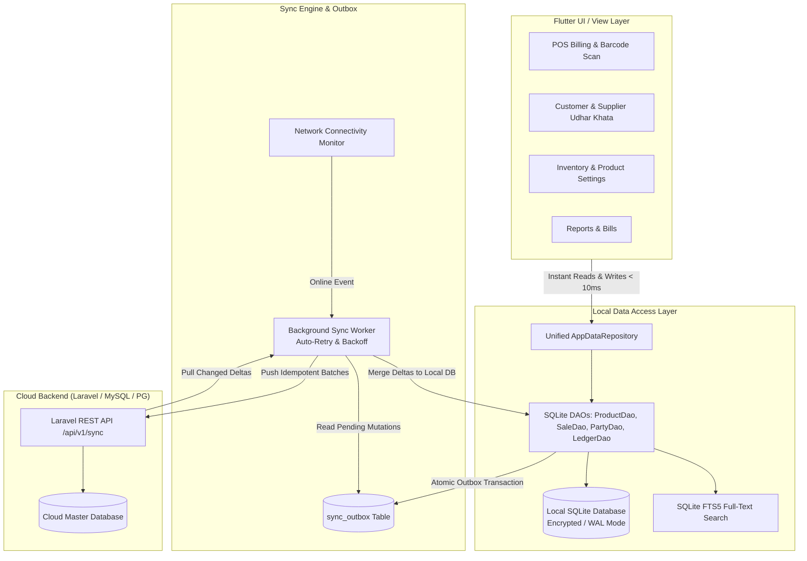
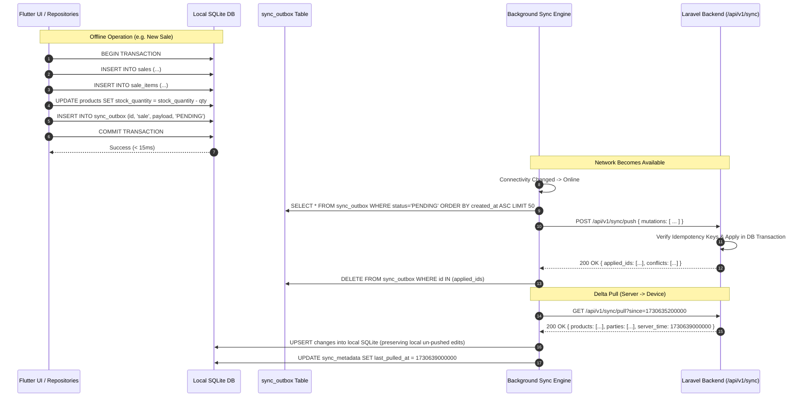

# pasal365 — Offline-First SQLite Architecture & Synchronization System Design

> **Document:** `systemofile.md`  
> **System:** pasal365 (Kirana & Retail POS Management)  
> **Platform:** Flutter Mobile (Android/iOS) + Laravel REST API Cloud Backend  
> **Core Architecture:** Local-First / Offline-First with SQLite (`sqflite`) and Background Bi-Directional Delta Sync  

---

## 1. Executive Summary & Problem Context

Kirana stores and retail shops operate in high-throughput, latency-critical environments. In Nepal and South Asia, physical stores experience:
- Frequent internet drops, unstable 4G LTE, and power outages.
- High cashier pressure during peak hours: customers expect instant barcode beeps and receipt prints in under **100 milliseconds**.
- Waiting for cloud network roundtrips (300ms–2000ms) per item scan or bill completion results in stalled queues and lost sales.

### The Architectural Mandate: **Local-First**
- **Single Source of Truth for the UI:** The local SQLite database is the primary datastore for all UI reads and writes.
- **Zero Network Blocking:** All core retail operations (POS billing, barcode scanning, stock adjustments, customer/supplier khata entries, receipt printing, daily reporting) execute 100% offline with zero internet dependency.
- **Cloud Backend as Central Replica:** The Laravel backend acts as the multi-device coordinator, cloud backup, inventory reconciliation hub, and master analytics engine.



---

## 2. Core Architectural Principles

1. **ACID Local Transactions:** When a sale is completed offline, the invoice creation, item line insertions, stock deductions, customer ledger adjustments, and outbox queue entries are committed within a single **atomic SQLite transaction** (`db.transaction()`).
2. **UUID v4 Identifiers:** All primary keys (`id`) across all entities are generated locally as standard UUID v4 strings. This eliminates auto-increment ID collisions when multiple offline devices create sales simultaneously.
3. **Idempotency Guarantee:** Every mutation pushed to the server carries an `idempotency_key` (the unique ID of the `sync_outbox` entry). Replays or network drops never produce duplicate sales or payments.
4. **Append-Only Ledgers:** Financial transactions (Sales, Udhar/Khata debits & credits, Payments) are immutable append-only records. They are never updated or overwritten in-place, preventing financial divergence during sync.
5. **Delta-Based Stock Accounting:** Stock decreases on the server using delta quantities (`stock = stock - item.qty`) rather than absolute overwrites, preventing accidental overwriting of inventory adjusted on another device.
6. **Tombstone Deletions:** Deletions are soft (`deleted_at IS NOT NULL` / `is_deleted = 1`) so delete operations propagate reliably across all offline clients.

---

## 3. SQLite Database Schema Specification

The database will be named `pasal365_local.db` and initialized with `PRAGMA foreign_keys = ON;` and `PRAGMA journal_mode = WAL;` (Write-Ahead Logging for high concurrency without UI stalls).

### 3.1 Metadata & Sync Engine Tables

#### `sync_outbox`
Stores local mutations waiting to be pushed to the Laravel cloud API.
```sql
CREATE TABLE sync_outbox (
    id TEXT PRIMARY KEY,               -- UUID v4 (serves as Idempotency Key)
    shop_id TEXT NOT NULL,
    entity_type TEXT NOT NULL,         -- 'product', 'category', 'sale', 'customer', 'supplier', 'ledger', 'expense'
    entity_id TEXT NOT NULL,           -- UUID of the mutated entity
    action TEXT NOT NULL,              -- 'CREATE', 'UPDATE', 'DELETE'
    payload TEXT NOT NULL,             -- JSON string of the entity snapshot or diff
    status TEXT NOT NULL DEFAULT 'PENDING', -- 'PENDING', 'IN_FLIGHT', 'COMPLETED', 'FAILED'
    retry_count INTEGER DEFAULT 0,
    max_retries INTEGER DEFAULT 10,
    last_error TEXT,
    created_at INTEGER NOT NULL,       -- Epoch milliseconds
    processed_at INTEGER
);

CREATE INDEX idx_sync_outbox_status ON sync_outbox(status, created_at);
CREATE INDEX idx_sync_outbox_entity ON sync_outbox(entity_type, entity_id);
```

#### `sync_metadata`
Tracks server synchronization watermarks for incremental pull.
```sql
CREATE TABLE sync_metadata (
    entity_type TEXT PRIMARY KEY,      -- 'products', 'categories', 'sales', 'parties', 'expenses'
    last_pulled_at INTEGER NOT NULL,   -- Timestamp of last successful delta fetch
    last_pushed_at INTEGER NOT NULL,
    sync_token TEXT
);
```

---

### 3.2 Product & Inventory Domain

#### `categories`
```sql
CREATE TABLE categories (
    id TEXT PRIMARY KEY,               -- UUID v4
    shop_id TEXT NOT NULL,
    name TEXT NOT NULL,
    slug TEXT NOT NULL,
    icon TEXT,
    color TEXT,
    is_deleted INTEGER DEFAULT 0,
    created_at INTEGER NOT NULL,
    updated_at INTEGER NOT NULL,
    sync_status INTEGER DEFAULT 1      -- 0 = Synced, 1 = Modified Locally
);

CREATE UNIQUE INDEX idx_categories_shop_slug ON categories(shop_id, slug);
```

#### `products`
```sql
CREATE TABLE products (
    id TEXT PRIMARY KEY,               -- UUID v4
    shop_id TEXT NOT NULL,
    category_id TEXT,
    name TEXT NOT NULL,
    nepali_name TEXT,
    sku TEXT NOT NULL,
    barcode TEXT,
    description TEXT,
    purchase_price REAL DEFAULT 0.0,
    purchase_unit TEXT DEFAULT 'pkt',
    selling_price REAL NOT NULL,
    selling_unit TEXT DEFAULT 'pkt',
    stock_quantity REAL DEFAULT 0.0,
    low_stock_threshold REAL DEFAULT 5.0,
    enable_low_stock_alert INTEGER DEFAULT 1,
    image_url TEXT,
    is_deleted INTEGER DEFAULT 0,
    created_at INTEGER NOT NULL,
    updated_at INTEGER NOT NULL,
    sync_status INTEGER DEFAULT 1,     -- 0 = Synced, 1 = Local Change
    FOREIGN KEY (category_id) REFERENCES categories(id) ON DELETE SET NULL
);

CREATE INDEX idx_products_barcode ON products(barcode);
CREATE INDEX idx_products_sku ON products(sku);
CREATE INDEX idx_products_shop_stock ON products(shop_id, stock_quantity);
```

#### `products_fts` (Full-Text Search Virtual Table)
Provides instantaneous sub-millisecond prefix & substring search for cashier typing.
```sql
CREATE VIRTUAL TABLE products_fts USING fts5(
    product_id UNINDEXED,
    name,
    nepali_name,
    sku,
    barcode,
    tokenize='unicode61'
);
```

#### `stock_movements` (Audit Trail)
```sql
CREATE TABLE stock_movements (
    id TEXT PRIMARY KEY,
    shop_id TEXT NOT NULL,
    product_id TEXT NOT NULL,
    movement_type TEXT NOT NULL,       -- 'SALE', 'PURCHASE', 'ADJUST_ADD', 'ADJUST_REMOVE', 'RETURN'
    quantity REAL NOT NULL,
    unit TEXT NOT NULL,
    stock_before REAL NOT NULL,
    stock_after REAL NOT NULL,
    reference_id TEXT,                 -- sale_id or purchase_id
    reason TEXT,
    note TEXT,
    created_at INTEGER NOT NULL,
    sync_status INTEGER DEFAULT 1,
    FOREIGN KEY (product_id) REFERENCES products(id) ON DELETE CASCADE
);

CREATE INDEX idx_stock_movements_prod ON stock_movements(product_id, created_at);
```

---

### 3.3 Sales, Invoices & Payments Domain

#### `sales`
```sql
CREATE TABLE sales (
    id TEXT PRIMARY KEY,               -- UUID v4
    shop_id TEXT NOT NULL,
    receipt_number TEXT NOT NULL,      -- e.g., 'INV-KRM-DEV1-00042'
    customer_id TEXT,
    cashier_id TEXT,
    cashier_name TEXT,
    subtotal REAL NOT NULL,
    discount_type TEXT DEFAULT 'fixed',-- 'fixed' or 'percentage'
    discount_amount REAL DEFAULT 0.0,
    tax_percentage REAL DEFAULT 0.0,
    tax_amount REAL DEFAULT 0.0,
    grand_total REAL NOT NULL,
    payment_status TEXT NOT NULL,      -- 'PAID', 'PARTIAL', 'CREDIT', 'CANCELLED'
    primary_payment_method TEXT NOT NULL, -- 'Cash', 'Fonepay_QR', 'Card', 'Credit'
    cash_tendered REAL DEFAULT 0.0,
    change_returned REAL DEFAULT 0.0,
    udhar_amount REAL DEFAULT 0.0,
    items_count INTEGER NOT NULL,
    note TEXT,
    is_cancelled INTEGER DEFAULT 0,
    cancelled_reason TEXT,
    cancelled_at INTEGER,
    created_at INTEGER NOT NULL,
    updated_at INTEGER NOT NULL,
    sync_status INTEGER DEFAULT 1,
    FOREIGN KEY (customer_id) REFERENCES customers(id) ON DELETE SET NULL
);

CREATE UNIQUE INDEX idx_sales_receipt ON sales(shop_id, receipt_number);
CREATE INDEX idx_sales_created ON sales(created_at DESC);
CREATE INDEX idx_sales_customer ON sales(customer_id);
```

#### `sale_items`
```sql
CREATE TABLE sale_items (
    id TEXT PRIMARY KEY,
    sale_id TEXT NOT NULL,
    product_id TEXT NOT NULL,
    product_name TEXT NOT NULL,
    sku TEXT NOT NULL,
    quantity REAL NOT NULL,
    unit_name TEXT NOT NULL,
    unit_price REAL NOT NULL,
    purchase_cost REAL DEFAULT 0.0,
    discount_amount REAL DEFAULT 0.0,
    total_price REAL NOT NULL,
    created_at INTEGER NOT NULL,
    FOREIGN KEY (sale_id) REFERENCES sales(id) ON DELETE CASCADE,
    FOREIGN KEY (product_id) REFERENCES products(id) ON DELETE RESTRICT
);

CREATE INDEX idx_sale_items_sale ON sale_items(sale_id);
```

#### `payments`
```sql
CREATE TABLE payments (
    id TEXT PRIMARY KEY,
    shop_id TEXT NOT NULL,
    payable_type TEXT NOT NULL,        -- 'Sale', 'CustomerLedger', 'SupplierLedger'
    payable_id TEXT NOT NULL,
    payment_method TEXT NOT NULL,      -- 'Cash', 'Fonepay_QR', 'Card', 'Credit'
    amount REAL NOT NULL,
    transaction_reference TEXT,
    created_at INTEGER NOT NULL,
    sync_status INTEGER DEFAULT 1
);

CREATE INDEX idx_payments_payable ON payments(payable_type, payable_id);
```

---

### 3.4 Parties (Customers & Suppliers) & Udhar Khata

#### `customers`
```sql
CREATE TABLE customers (
    id TEXT PRIMARY KEY,
    shop_id TEXT NOT NULL,
    name TEXT NOT NULL,
    phone TEXT NOT NULL,
    address TEXT,
    credit_limit REAL DEFAULT 0.0,
    outstanding_udhar REAL DEFAULT 0.0,
    is_active INTEGER DEFAULT 1,
    is_deleted INTEGER DEFAULT 0,
    created_at INTEGER NOT NULL,
    updated_at INTEGER NOT NULL,
    sync_status INTEGER DEFAULT 1
);

CREATE UNIQUE INDEX idx_customers_phone ON customers(shop_id, phone);
CREATE INDEX idx_customers_udhar ON customers(outstanding_udhar DESC);
```

#### `customer_ledgers` (Udhar Khata Double-Entry)
```sql
CREATE TABLE customer_ledgers (
    id TEXT PRIMARY KEY,
    shop_id TEXT NOT NULL,
    customer_id TEXT NOT NULL,
    transaction_type TEXT NOT NULL,    -- 'CREDIT_SALE', 'PAYMENT_RECEIVED', 'DISCOUNT_ALLOWED', 'OPENING_BALANCE'
    reference_no TEXT,                 -- invoice receipt_number or payment slip
    amount REAL NOT NULL,              -- positive number
    balance_after REAL NOT NULL,       -- recalculated running balance
    payment_method TEXT,
    note TEXT,
    created_at INTEGER NOT NULL,
    sync_status INTEGER DEFAULT 1,
    FOREIGN KEY (customer_id) REFERENCES customers(id) ON DELETE CASCADE
);

CREATE INDEX idx_customer_ledgers ON customer_ledgers(customer_id, created_at DESC);
```

#### `suppliers` & `supplier_ledgers`
```sql
CREATE TABLE suppliers (
    id TEXT PRIMARY KEY,
    shop_id TEXT NOT NULL,
    name TEXT NOT NULL,
    company_name TEXT,
    phone TEXT NOT NULL,
    pan_number TEXT,
    address TEXT,
    outstanding_payable REAL DEFAULT 0.0,
    is_deleted INTEGER DEFAULT 0,
    created_at INTEGER NOT NULL,
    updated_at INTEGER NOT NULL,
    sync_status INTEGER DEFAULT 1
);

CREATE TABLE supplier_ledgers (
    id TEXT PRIMARY KEY,
    shop_id TEXT NOT NULL,
    supplier_id TEXT NOT NULL,
    transaction_type TEXT NOT NULL,    -- 'PURCHASE_BILL', 'PAYMENT_MADE', 'PURCHASE_RETURN'
    reference_no TEXT,
    amount REAL NOT NULL,
    balance_after REAL NOT NULL,
    payment_method TEXT,
    note TEXT,
    created_at INTEGER NOT NULL,
    sync_status INTEGER DEFAULT 1,
    FOREIGN KEY (supplier_id) REFERENCES suppliers(id) ON DELETE CASCADE
);
```

---

### 3.5 Expenses Domain

#### `expenses`
```sql
CREATE TABLE expenses (
    id TEXT PRIMARY KEY,
    shop_id TEXT NOT NULL,
    category_name TEXT NOT NULL,       -- 'Rent', 'Electricity', 'Staff Salary', 'Tea/Snacks', 'Transport'
    title TEXT NOT NULL,
    amount REAL NOT NULL,
    payment_method TEXT DEFAULT 'Cash',
    receipt_image_path TEXT,
    note TEXT,
    expense_date INTEGER NOT NULL,     -- Epoch milliseconds
    is_deleted INTEGER DEFAULT 0,
    created_at INTEGER NOT NULL,
    updated_at INTEGER NOT NULL,
    sync_status INTEGER DEFAULT 1
);

CREATE INDEX idx_expenses_date ON expenses(expense_date DESC);
```

---

## 4. Offline Invoice Numbering Strategy

In an offline multi-terminal environment, traditional auto-increment sequential bill numbers (`1, 2, 3...`) cause collisions if two cashiers bill offline at the same time.

### Solution: Device-Partitioned Invariant Numbering
The local database stores a `device_id` (generated on first boot) and a sequence counter:
$$\text{Receipt Number} = \text{INV}-\text{YYMM}-\text{DEVICE\_PREFIX}-\text{LPAD(SEQUENCE, 5, '0')}$$

*Example:* `INV-2611-D1-00124`

- **Offline Safety:** Terminal 1 generates `INV-2611-D1-00124`, while Terminal 2 generates `INV-2611-D2-00089`. No collision is mathematically possible.
- **Human-Readable:** Cashiers and customers can easily read, verify, and search bills.
- **Printed on Receipts:** Thermal bills display this exact receipt number with QR code for verification.

---

## 5. Bi-Directional Synchronization Engine



### 5.1 Push Protocol (Client to Cloud)
- **Endpoint:** `POST /api/v1/sync/push`
- **Payload:** Batches of up to 50 mutations from `sync_outbox`.
- **Idempotency:** The backend checks the `idempotency_key` against a `processed_mutations` table. If already applied, it returns `SUCCESS` without re-executing.
- **Backoff:** If the push fails due to 5xx or network timeout, the item's `retry_count` increments with exponential backoff:
  $$T_{\text{wait}} = \min(2^{\text{retry\_count}} \times 1.5\text{s}, 60\text{s})$$

### 5.2 Pull Protocol (Cloud to Client)
- **Endpoint:** `GET /api/v1/sync/pull?since={timestamp}`
- **Payload:** Returns all entities updated or soft-deleted on the server after `{timestamp}`.
- **Local Application:**
  - If a local record has `sync_status == 0` (clean), the server version cleanly overwrites it.
  - If a local record has `sync_status == 1` (modified offline, not yet synced), conflict resolution applies.

### 5.3 Conflict Resolution Rules
| Entity Type | Conflict Scenario | Resolution Rule |
| :--- | :--- | :--- |
| **Sales & Receipts** | Never conflicts (UUID + Device Partition) | **Immutable Append**: Server accepts device bill as truth. |
| **Product Stock** | Server stock differs from local stock | **Delta Merging**: Apply `delta_quantity` instead of absolute values. |
| **Product Details (Price, Name)** | Edited offline on device & also on web portal | **LWW (Last-Write-Wins)** based on `updated_at` millisecond timestamp. |
| **Customer Khata** | Payments received on multiple devices | **Ledger Append**: Both payment records are recorded; running balance is recalculated deterministically. |
| **Categories / Units** | Name changed on both ends | **Server Wins**; local cache updates cleanly. |

---

## 6. Offline Full-Text Search (SQLite FTS5)

In physical retail, cashier typing speed is vital. Standard SQL `LIKE '%query%'` scans cause UI frame drops when inventory grows past 5,000 items.

- SQLite's **FTS5 (Full-Text Search 5)** virtual table will index `name`, `nepali_name`, `sku`, and `barcode`.
- Prefix queries: `SELECT * FROM products_fts WHERE products_fts MATCH 'wai* OR noodles*'` return matched products in **under 2 milliseconds** on low-end Android hardware.
- Synchronized with triggers on `products` table insert, update, and delete.

---

## 7. Migration & Implementation Blueprint

```mermaid
graph LR
    P1[Phase 1:\nSQLite Foundation\n& DAOs] --> P2[Phase 2:\nOffline Repository\nRefactor]
    P2 --> P3[Phase 3:\nSync Engine &\nOutbox Worker]
    P3 --> P4[Phase 4:\nBackend Sync APIs\n(Laravel)]
    P4 --> P5[Phase 5:\nVerification &\nOffline E2E Tests]
```

### Phase 1: Dependencies & Database Schema
1. Add dependencies to `app/pubspec.yaml`:
   - `sqflite: ^2.4.1` (SQLite engine for Android, iOS, macOS)
   - `sqflite_common_ffi: ^2.3.4` (for Windows / Linux / Unit tests)
   - `path: ^1.9.0` (path utilities)
   - `uuid: ^4.5.1` (UUID v4 generation)
   - `connectivity_plus: ^6.1.1` (real-time network connectivity listener)
2. Implement `AppDatabase` singleton (`app/lib/core/database/app_database.dart`) managing SQLite versioning, migration migrations, and connection pooling.
3. Implement Domain DAOs (`ProductDao`, `SaleDao`, `PartyDao`, `ExpenseDao`, `SyncOutboxDao`).

### Phase 2: Repository Layer Refactoring
1. Update `AppDataRepository` to read and write directly to SQLite DAOs.
2. Ensure UI screens (`ProductsScreen`, `SalesScreen`, `PartiesScreen`, `DashboardScreen`, `MoreScreen`) continue receiving instant reactive updates via `ChangeNotifier` / `ValueNotifier`.
3. When creating an invoice or updating inventory, `AppDataRepository` writes to SQLite and immediately completes with zero latency.

### Phase 3: Sync Engine & Outbox Background Worker
1. Implement `SyncEngine` (`app/lib/core/sync/sync_engine.dart`):
   - Listens to connectivity changes (`connectivity_plus`).
   - Periodic timer (every 60 seconds when app is active).
   - Manual trigger (when user taps "Re-sync Catalog" or "Refresh Data").
2. Implement queue drainer: reads `sync_outbox`, packages payload, calls `ApiClient`, marks processed.

### Phase 4: Backend Sync Endpoints (Laravel)
1. `POST /api/v1/sync/push`: Processes batched mutations inside a database transaction, updates Cloud MySQL/PostgreSQL, tracks idempotency keys.
2. `GET /api/v1/sync/pull`: Returns incremental entity changes (`products`, `customers`, `suppliers`, `sales`) based on `since` timestamp.

### Phase 5: Testing & Reliability Verification
1. **Airplane Mode Test:** Turn off WiFi and Mobile Data, create 10 sales, scan barcodes, print thermal receipts, add 2 customers, take an expense. Everything must execute smoothly without errors.
2. **Reconnection Test:** Re-enable internet. All 10 sales and mutations must automatically sync to the Laravel backend within seconds.
3. **Multi-device Conflict Test:** Simulate two devices modifying stock or recording udhar payments for the same customer while offline. Verify clean, non-destructive ledger reconciliation.

---

## 8. Summary of Benefits

| Feature | Before (Online-Dependent) | After (Offline-First SQLite) |
| :--- | :--- | :--- |
| **POS Checkout Speed** | 800ms – 2500ms (network bound) | **< 20ms** (local SQLite transaction) |
| **Barcode Lookup** | Dependent on backend response | **< 2ms** (local B-Tree & FTS5 index) |
| **Shop Operation During Internet Outage** | App blocked / spinning loaders | **100% Fully Functional** (sales, bills, khata, printing) |
| **Data Loss on Connection Drop** | In-flight requests could fail | **Zero Data Loss** (persisted in SQLite Outbox) |
| **Receipt Generation** | Waiting for server response | **Instant** thermal printing on bill completion |
